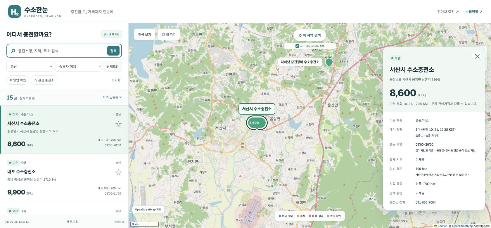

# 수소한눈 검증 결과

확인일: 2026-10-21 KST.

| 검증 | 결과 |
|---|---|
| 최초 실제 수집 | 하잉 공개 지도 조회 응답 248곳. 좌표 248·가격 248. 전국 전체 총량은 별도 미검증 |
| 단위·계약 검사 | Node 8개 + Python 6개 = 14개 통과 |
| 정적 검사·빌드 | npm run check, npm run build 통과 |
| 압축·무결성 | 약 355 KB → 47 KB, 약 87% 절감. 빌드 및 공개 HTTPS 브라우저에서 gzip 압축해제·SHA-256·건수·지역 집계 대조 통과 |
| 데스크톱 UI | 1363px에서 목록·지도 표시, 충남 15곳, 가격 정렬, 서산 충전소 상세, 선택 마커 1개, 닫기 후 결과 15곳과 배율 유지 확인 |
| 지도 기본 제공자 | 번들 Leaflet + 실제 OpenStreetMap 타일 로드 확인. 네이버 SDK 선택 연동은 별도 origin/인증 검증 필요 |
| 모바일 UI | 개발 미리보기와 실제 공개 HTTPS 사이트를 390×844에서 확인. 가로폭 390/scrollWidth 390, 승용 결과 239곳. 목록 확장 전후 결과 239곳 유지, 목록 높이 약 228→374.5px 확인 |
| 수집현황 UI | 공개 HTTPS에서 실제 gzip 로드, SHA-256 일치, 전체·지역·좌표 집계 대조 확인. 확인 시점 2026-10-21 12:56 KST 수집본: 248곳 중 원천·수집 모두 15분 이내 240곳, 확인 지연/원천 시각 미제공 8곳. 시설 전체를 현재 영업 가능으로 표시하지 않음 |
| 개인정보 최소화 | 원본 담당자 이름·이메일·개인전화·사업자번호 제외를 자동 검사 |
| 장애 보존 | 오류 시 원래 snapshot·수집시각 유지, 안전한 오류코드만 저장하는 테스트 통과 |
| 실제 Actions | [39515571924](https://github.com/softm/hydrogenstation/actions/runs/39515571924) 2차 실행: 수집·14개 테스트·빌드·Pages 설정·업로드·공개 배포·배포 파일 검증 모두 성공 |
| 공개 배포 | **완료**. Pages Source=GitHub Actions. 운영 URL·수집현황·개인정보 페이지 HTTP 성공, 실제 gzip/SHA·248곳·배포 소스 revision 대조 통과. 최초 검증 revision `9ad72328f3f7913026c5f550768834ce732cc294` |
| 추가 연결 | 공공 운영·실시간 API 인증, 수소한눈 전용 AdFit 광고단위·승인, 위치 권한의 실제 사용자 승인 여부는 별도 조건 |

## 운영 설정

1. [hydrogenstation Pages 설정](https://github.com/softm/hydrogenstation/settings/pages)의 Source는 **GitHub Actions**로 적용 완료했다. 브랜치 직접 배포를 함께 사용하지 않는다.
2. 매시 7·22·37·52분 예약 수집·배포가 구성되어 있다. GitHub에서 지연·누락될 수 있으며 원래 수집 시각과 원천 갱신 시각을 유지한다.
3. 일반 사용 중 수동 실행은 필요하지 않다. 즉시 복구가 필요하면 [Actions](https://github.com/softm/hydrogenstation/actions)에서 Run workflow를 선택한다.

공개 운영 주소: https://softm.github.io/hydrogenstation/ (루트. `/dist` 사용 안 함).

수집현황: https://softm.github.io/hydrogenstation/data-status.html

## 공개 사이트 확인 화면

공개 충전소 위치·상세정보를 선택한 실제 운영 화면이다. 사용자 현재 위치를 포함하지 않았다.

